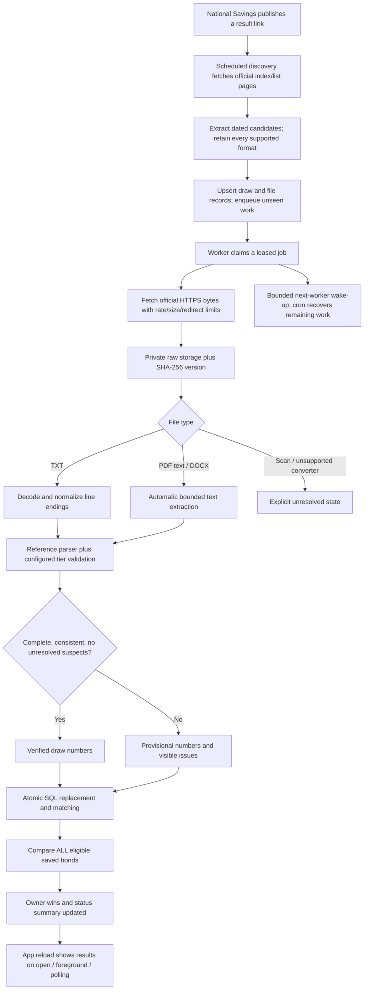

# BondCheck — detailed implementation, automation and verification audit

**Audit date:** 27 October 2026. **Project:** `dwagvpxegvixgztmovyx`. **Latest installed Android release:** 1.7.1 / version code 9.

This document describes the actual implementation and observed evidence. A feature being implemented, a migration being deployed, an automated test passing and a full real-world scenario being verified are different states. They are distinguished below.

## 1. Seedha jawab — owner ke liye

- Rozmarrah ka intended flow: account mein log in karein, denomination + six-digit number + purchase date add karein. Series optional hai. Single, range aur paste entry hain; range ki limit 2,000 numbers hai.
- Aap ki **latest instruction** ke mutabiq purchase date se **strictly baad** ki draw hi aap ki win ban sakti hai. 2016 mein khareeda bond 2015 ki draw par aap ki win nahin hai. Same-day draw bhi is strictly-after rule mein exclude hoti hai.
- Naya bond save hote hi database us ki eligible stored history check karta hai. Purane results ko dobara website se download karna zaroori nahin.
- Future official result discovery, download, parsing aur matching server par scheduled hain. Normal server automation ko app khuli rehne ki zaroorat nahin.
- Official result files ki automatic fetching pehle certificate-chain fault par fail thi. Us ki secure repair live server par test ho chuki hai; certificate verification disable nahin ki gayi.
- Ab **177 official draws** discover aur ingest ki gayi hain. Audit snapshot mein **164 verified**, **13 unresolved**, **245,393 stored number rows** aur **185 raw-file versions** thay. Unresolved results ko verified kehna ghalat hoga.
- Is liye abhi “har draw 100% accurately checked, kabhi review ki zaroorat nahin” ka wada nahin kiya ja sakta. Scan-only PDFs aur official files ki ambiguities abhi haqeeqi exceptions hain. App in ko chhupati nahin.
- Original splash, branded login/signup, loading, portfolio cards, bond rows, navigation aur View all/search flow restore kiye gaye hain. Backend badalne ka matlab design replace karna nahin hona chahiye tha.

## 2. Which requirement is authoritative?

The supplied automation specification originally required matching all historical draws regardless of purchase date. The owner subsequently gave an explicit correction: a draw before acquisition must not count as the owner's win. **The latest owner instruction supersedes that earlier rule.**

Current eligibility is:

```text
same six-digit number
AND same denomination
AND draw_date > purchased_on
AND bond is not soft-deleted
AND result status allows a verified or provisional match
```

Series letters do not affect the winning-number comparison. Purchase date is mandatory. A missing date is rejected rather than guessed. This is the application's requested ownership rule; it is not a determination of legal claim eligibility, claim deadlines or any additional National Savings issuance requirements.

Same-day draws are excluded because the requested rule was “after my date.” A different same-day policy would require an explicit change to this rule and its tests. There is no extra, hidden 60-day filter in cloud matching.

## 3. What existed before the cloud integration?

The original project was a React Native application with native Android/iOS projects, an established cream/green/gold visual system and reusable controls. It was not a web-localStorage app. Its database lived in AsyncStorage.

It already contained:

- Animated splash/logo, login/signup, local password flows, loading/logout screens and local fingerprint support.
- Home statistics, denomination breakdown, searchable bond rows and bottom navigation.
- Single, range and pasted-number entry, a staged review list and editing sheets.
- Local workspaces, members/invite codes, demonstration users and demonstration results.
- Claim/renew/archive/delete actions, CSV/Excel/PDF exports and local backups.

Those local users and demonstration results were not Supabase accounts or an official result feed. A local successful login did not establish access to a cloud database. The old local checker also used different matching/date assumptions, so it could not simply be relabelled as unattended official checking.

An earlier cloud route replaced the original account and portfolio screens with simpler cloud-only screens. That bypassed the original splash/loading experience and omitted the expected View all entry point. This was a UI regression. The current routing reuses the original visual components while connecting their data to Supabase.

## 4. Before / after inventory

| Area | Earlier state | Current implementation and reason |
|---|---|---|
| Official data | Local/demo/manual results | Official source discovery, raw files, validated parsed numbers |
| Persistent ownership | Device-local records | Owner-scoped Supabase bonds, protected by RLS |
| Account credentials | Prototype local accounts | Supabase Auth session in OS keychain; no service-role credential in the app |
| Splash/loading | Bypassed in initial cloud route | Original visual screens restored to cloud startup/login |
| Login/signup | Simplified cloud form | Original logo, shell, segmented login/signup, password controls and validation |
| Home | Replacement cloud list | Original greeting, cards, denomination table, badges and bond-row presentation |
| All bonds | Missing expected entry point | Home View all button opens a separate virtualized, searchable list |
| Date eligibility | Earlier specification ignored purchase date | Latest instruction enforced in SQL: strictly after purchase |
| Leading zeros | Vulnerable if treated numerically | Six-digit strings in input/JSON and fixed-width database fields |
| Series | Previously part of full-number matching | Display/deduplication metadata; ignored for draw matching |
| Range insertion | Repeated history work per inserted row | Statement-level rematching with consistent database locks |
| Official HTTPS | Broken site chain rejected | Verified missing intermediate supplied to the official-only server fetcher |
| CR-only text | Some real lists produced zero parsed winners | Decode-time newline normalization; raw bytes/hash unchanged |
| Rs100 history | Supplied spec assumed 1,696 third prizes before #51 | Official files establish 1,199 from observed #25 onward; configuration corrected |
| Joined digit cells | Some malformed cells could lose possible matches | Fixed-width six-digit possibilities retained provisionally |
| PDF text / DOCX | External conversion only | Automatic Edge text extraction, with limits and strict result validation |
| PDF scans | No reliable text | Explicit needs_ocr state; never silently approved |
| Manual approval | Partial list could be marked verified | Complete configured tier counts and matching raw-file version required |
| Download outage | Could remove previously found results | Prior accepted numbers retained as provisional matches |
| Background refresh | Official download error could block fresh server state | Server reload still runs; the download error remains visible |
| Taxes | Prototype estimated net figures | Cloud summaries use verified gross amounts; actual receipts are entered by owner |
| Scheduling | Definitions only | Four database cron jobs registered; worker/discovery execution observed |

## 5. Current UI and navigation flow

```mermaid
flowchart TD
    A[Open BondCheck] --> B[Original animated splash]
    B --> C{Saved valid session?}
    C -- No --> D[Branded Log in / Sign up]
    D --> E[Original loading presentation]
    C -- Yes --> F[Restore session and saved server data]
    E --> G[Original Home portfolio]
    F --> G
    G --> H[View all bonds]
    H --> I[FlatList, search and denomination filter]
    I --> J[Bond details / edit / claims]
    G --> K[Add: Single / Range / Paste / CSV]
    K --> L[Validate number, denomination and purchase date]
    L --> M[Preview range or paste; select rows; Save]
    M --> N[Atomic server insert and eligible-history matching]
    N --> G
    G --> O[Check: official draw status board]
    G --> P[Results: verified and possible wins]
    G --> Q[Settings: automation, backups, migration and logout]
```



Home is a portfolio overview. Its preview is bounded; View all opens the full list, including active and archived records. The all-bonds list searches number, denomination, holder, date and note. It uses FlatList virtualization instead of rendering thousands of row views at once. Opening a row returns to the existing bond-details sheet.

Signup uses the actual Supabase registration API. It does not create a fake local cloud account or automatically grant owner access. Registration, email confirmation and enrollment as the private owner are separate steps. The permanent owner's email/enrollment still needs to be supplied/configured; temporary device-test credentials must not become the owner's production identity.

The original insecure phone-only password reset is not reused for cloud passwords. The password-help screen explains the need for secure recovery. Fully configured email/deep-link recovery and cloud biometric unlocking are not claimed as verified features.

Local demo/workspace sharing remains prototype functionality. It is not presented as production multi-user Supabase sharing. The cloud design is a private owner account, as required by the automation specification.

## 6. What the owner enters

| Field | Rule |
|---|---|
| Denomination | Required: 100, 200, 750, 1500, 25000 or 40000 |
| Number | Required: exactly six digits as text; leading zeros preserved |
| Purchase date | Required, valid calendar date, stored as an ISO date |
| Series | Optional letters; retained for display/duplicate identity |
| Holder | Optional |
| Note/location | Optional |

Examples: `007447`, `AB007447` and `CD007447` retain the number `007447`. AB/CD distinguish two physical holdings but do not change the common draw result. `7447` is not silently padded during bond entry; the owner must enter all six digits.

Range endpoints are inclusive. `000001` through `002000` creates exactly 2,000 numbers. A 2,001-number range, a reversed range or mixed series prefixes is rejected. Range and paste entry open a preview; no rows are saved until Save is pressed. Invalid and duplicate rows are shown, not silently swallowed.

CSV requires `number,denomination,purchased_on`, with optional series/holder/note. Numeric spreadsheet conversions are not a substitute for preserving six-digit text. Old backups without a usable purchase date remain invalid in the migration preview until corrected; the original backup is retained.

## 7. What happens when a bond is saved?

1. The app validates the supported denomination, exact six-digit text and calendar date.
2. A range is sent as one PostgREST insert, so the batch is a database transaction rather than hundreds of unrelated partial uploads.
3. RLS checks that the authenticated account is an enrolled owner and owns the inserted rows.
4. A database statement trigger takes the matching lock and recomputes matches once for the statement.
5. SQL joins bonds to stored draw numbers on denomination and number, and requires the draw to be strictly later than purchase.
6. Verified source results create verified wins; unresolved parsed results create possible wins.
7. Unique constraints keep repeated operations from duplicating a bond/draw win.
8. The app reloads the server snapshot and updates the existing portfolio/results views.

There is no website download per bond. Adding 2,000 bonds does not mean downloading 2,000 copies of every result. The historical result corpus is stored once and matched in PostgreSQL.

### Ownership/date scenarios actually tested

| Scenario | Expected result | Evidence |
|---|---|---|
| Bought in 2016; same number won in 2015 | No owner win | Live pgTAP pass |
| Bought on a draw date | Excluded by strictly-after rule | Live pgTAP pass |
| Bought in 2016; matching draw in 2017 | Eligible match | Live pgTAP pass |
| Purchase date edited to 2018 after a 2017 match | Old ineligible win removed immediately | Live pgTAP pass |
| Same number, different denomination | No cross-denomination match | Live pgTAP pass |
| Same number held in two series | Independent wins for both eligible holdings | Live pgTAP pass |
| Recompute repeated | No duplicate win | Live pgTAP pass |
| Unresolved official result | Possible win only | Live pgTAP pass |
| Published result corrected | Stale match removed/recomputed | Live pgTAP pass |
| Temporary source outage | Previous numbers remain provisionally visible | Live pgTAP pass |
| Mark as seen | Acknowledgement saved without altering claim records | Database and physical-device evidence |
| 2,000 zero-prefixed numbers | Full batch preserved, no ineligible-date wins | Live rollback benchmark |

The benchmark inserted 2,000 synthetic holdings into a transaction against the real stored corpus: **495 ms**, **112 matches**, **0 ineligible-date wins**, and `000001` retained as six digits. It was rolled back. This is one measured database result, not a guarantee about every phone/network/load.

## 8. Complete new-result automation flow



**A new normal TXT result can be discovered, ingested and matched while the phone is closed.** The server knows the already-saved bonds. The phone is needed to view the updated result, not to perform the normal SQL matching.

This is polling, not a push event sent directly by National Savings. Publication is noticed at the next scheduled discovery. New links are found by scraping; filenames are not guessed. A filename or upload-folder year can be misleading, so the list-page date is authoritative and file-header dates are cross-checked.

No push notification service has been activated. If the app is closed, results can update on the server, but the owner is not promised an immediate Android notification. Opening/foregrounding the app reloads status and results.

## 9. Scheduling that is actually deployed

PostgreSQL schedules are UTC; the polling decision uses Asia/Karachi.

| Job | Registered schedule | Meaning |
|---|---|---|
| Discovery | Minute 17 hourly, guarded by poll_due | Daily around 06:17 PKT; more often in publication windows |
| Worker | Every five minutes, only with runnable work | Persistent queue recovery |
| Heartbeat | 02:13 UTC daily | Real API/database heartbeat |
| Watchdog | 02:43 UTC daily | Detect missing successful discovery and expired leases |

Publication-window policy: hourly on days 10, 11, 15, 16, 17; every two hours during days 9–22 otherwise; daily outside those periods. The calendar changes polling intensity; it does not manufacture draws or decide whether a real link exists.

The audit observed three successful discovery cron SQL executions and 36 successful worker cron SQL executions at the snapshot. Daily heartbeat/watchdog cron runs had not yet reached their next scheduled time; a manual authenticated heartbeat HTTP call was separately verified. Cron SQL success alone does not prove an HTTP worker succeeded, so actual queue drain/results were also checked.

Workers claim jobs with row locks, SKIP LOCKED and a lease token. A stale invocation cannot finish a newer lease. Retries back off (one minute, five minutes, thirty minutes, then hours), with a final failed state instead of endless hidden retries. Enqueueing while a job runs requests another pass. Bounded chains reduce backfill delay, and five-minute cron survives the end of a chain or a closed app.

GitHub workflow files exist for an independent keep-alive, document conversion and backups. They have **not** been proven activated with repository secrets and successful scheduled runs. They must not be counted as an operational second scheduler yet. A paused Supabase project cannot be restored by its own paused cron; restoration still requires the account owner/dashboard.

## 10. Historical corpus and coverage boundary

At the recorded live snapshot:

| Measure | Observed |
|---|---:|
| Active denomination sources discovered | 6 |
| Official draws represented | 177 |
| Earliest listed result ingested | 15 January 2019 |
| Latest listed result ingested | 15 October 2026 |
| Candidate files/raw versions | 185 |
| Verified draws | 164 |
| Draws needing attention | 13 |
| Stored winner/possible-number rows | 245,393 |
| Stored raw bytes | 23,172,077 |
| Finished ingestion jobs | 224 |
| Pending/failed jobs at this snapshot | 0 / 0 |

Zero pending jobs means processing attempts completed; it does **not** mean every document was verified. The status board must still show the 13 unresolved draws.

The currently discovered official lists start in 2019. This is not evidence that 2016–2018, or every result ever published, has been covered. A 2016 purchase date is correctly applied to the available 2019+ corpus. Missing older official history remains a coverage limitation, not a reason to invent numbers or claim completeness.

### Unresolved results at the snapshot

| Denomination | Draw date | State | Main reason |
|---:|---|---|---|
| 100 | 2019-08-15 | needs_ocr | Scan/PDF lacks usable result text |
| 100 | 2020-08-15 | needs_ocr | Scan/PDF lacks usable result text |
| 100 | 2021-08-15 | needs_review | Missing/ambiguous draw structure/header; partial parsed tiers |
| 200 | 2019-09-16 | needs_review | Extra repeated zero cells / tier-count mismatch |
| 200 | 2022-03-15 | needs_review | Extra repeated zero cells / tier-count mismatch |
| 750 | 2024-01-15 | incomplete | Legacy Word/first-page candidate needs a complete source |
| 750 | 2024-10-15 | needs_review | First/second tiers not reliably extracted |
| 750 | 2026-10-15 | needs_review | Official short token 7447; possible 007447 remains provisional |
| 1500 | 2026-08-17 | needs_ocr | Image-only PDF; measured text extraction produced only whitespace |
| 25000 | 2023-12-11 | needs_ocr | PDF requires OCR/verified readable content |
| 40000 | 2019-03-11 | needs_review | Repeated zero cells; third-tier count mismatch |
| 40000 | 2020-12-10 | needs_review | First prize not reliably extracted |
| 40000 | 2023-12-12 | needs_ocr | PDF requires OCR/verified readable content |

These rows are a release-readiness limitation for a claim that *all* history has been checked without human attention. A scan with no extracted numbers cannot establish that the owner did not win. Its unresolved status must remain visible. No OCR result is silently promoted to certain truth.

## 11. Certificate fault: cause and secure repair

Both Supabase Edge and the physical Infinix rejected National Savings HTTPS initially. The server's leaf was `*.savings.gov.pk`, issued by **GoGetSSL RSA DV SSL CA 2**, while its supplied chain included the older **GoGetSSL RSA DV CA**. The correct intermediate was missing.

The correct CA certificate was obtained from the leaf's official issuer AIA URL:

- [GoGetSSL RSA DV SSL CA 2 certificate](http://crt.sectigo.com/GoGetSSLRSADVSSLCA2.crt)
- Issuer/root: Sectigo Public Server Authentication Root R46.
- CA SHA-256: `B5:28:67:96:DA:DF:16:52:1D:E4:17:72:AB:2F:DB:58:18:72:99:71:B5:27:47:21:14:6C:6E:81:72:BE:FE:07`.
- Its signature was verified against the runtime's built-in trusted R46 root before use. The AIA certificate transport does not itself establish trust; signature/root verification does.

The server fetcher supplies this verified intermediate while retaining certificate, expiry and hostname validation. It is used through the strict official-domain allowlist. It does not accept arbitrary hosts or turn TLS verification off.

After repair, the deployed spike fetched the known Rs750 list, 105th TXT and PDF with HTTP 200. Discovery then found all six source pages and the real corpus. A PDF conversion probe of the August-2026 Rs1500 scan returned 200, 1,638,992 bytes, 75 ms conversion time and only two whitespace characters: useful evidence that this file needs OCR rather than ordinary text extraction.

Native device fallback still uses platform TLS trust. It failed against the site's broken chain on this phone. Healthy server discovery now takes priority, so the app does not repeatedly invoke that failing fallback while the server is functioning.

## 12. Parsing, verification and why some results remain provisional

The reference parser was reused. Production integration adds decoded CR/CRLF normalization, candidate retention, structure configuration and SQL checks. Raw bytes are not edited before hashing/storage.

Verification checks tier counts, duplicates, suspicious number widths, known denomination/structure and conflicting candidate results. Prize amounts come from configuration, not an unreliable printed amount. Independently valid TXT/PDF candidates that disagree require review; an explicitly revised same-format candidate can supersede an older original.

For a short official token such as 7447, the app retains possible 007447 and marks the draw/matches provisional. The owner is not told that the padded value is certain. Joined fixed-width digit cells also produce provisional six-digit possibilities rather than silently losing every possible match.

Real official evidence disproved an assumption in the supplied specification: Rs100 #25 (2019), #48, #49 and #50 contain 1,199 third prizes, not a change starting only at #51. A structure beginning at observed draw #25 was added. Examples retained during verification include:

- #25 raw SHA-256 `f181e54fe5af66e76083b425947b288e3027b9362a18f1eac008e6f5b12d18f5`.
- #49 raw SHA-256 `38f6d0fcb316b54c186ea1cdf64750bf219ff0b40189b6209d3bf8c12d7e7fc4` and CR-only line endings.
- #50 raw SHA-256 `db4740dfc57dbf44a3f3429c8809a8307aaf93ec34af01e86d856ee9b2ca90ca`.

Automatic `ok` results and manual approvals are also checked in PostgreSQL. A client cannot submit one number and turn an incomplete 1,700-number draw into a verified draw. Manual approval requires the complete configured tier counts, a verification note and the exact accepted raw-file hash. A changed hash rejects stale approval.

On source outage, previously accepted numbers remain provisional instead of disappearing. On a real correction, matches are recomputed and stale wins are removed. Acknowledgement is separate from claim date/received amount.

## 13. Database and security model

Important tables:

| Table | Purpose |
|---|---|
| app_owners | Explicit private-owner enrollment |
| sources | Six discovered official list pages and discovery metadata |
| prize_structures | Counts and amounts by denomination/draw range |
| bonds | Owner holdings, six-digit number, series, purchase date, archive/delete metadata |
| draws | One denomination/date result, status, issues and accepted source hash |
| draw_files | All candidates, source URL, format, hash and parse metadata |
| draw_file_versions | Raw byte provenance for corrections |
| draw_numbers | Parsed verified/provisional number/tier records |
| wins | Per-bond/per-draw matches, acknowledgement and claims |
| draw_checks | Matching audit counts |
| ingest_jobs | Persistent work, leases, retries and deduplication |
| pipeline_events | Operational and correction audit trail |
| heartbeat / fetch_clock | Freshness monitoring and global official-request spacing |

RLS is enabled. An enrolled owner can read/write their bonds and read allowed results. Unenrolled authenticated accounts and anonymous callers cannot read private holdings. The app cannot write official draw tables or call service-only matching/scheduler RPCs. The raw and backup buckets are private; owner access is controlled by storage policies.

Only the public project key is bundled. The service-role credential stays in Supabase's server environment/CI. Scheduler credentials were generated inside PostgreSQL, stored in Vault and never printed or put in the APK. Handler authentication checks the scheduler credential or the real JWT plus owner membership even with gateway verify_jwt disabled.

Database advisory notices must be interpreted rather than hidden: operational RLS tables intentionally have no client policy; intended authenticated SECURITY DEFINER RPCs perform explicit owner checks. Leaked-password protection was reported disabled and has not been claimed as configured. Private signup/enrollment, recovery configuration and production credential handling remain setup responsibilities.

## 14. Accuracy controls and remaining boundaries

Implemented controls reduce false positives and silent failures:

- Required purchase date and SQL date predicate, not a front-end-only filter.
- Number/denomination matching; series ignored only for the common result comparison.
- Strict six-digit input, zero preservation and duplicate constraints.
- Full tier-count checks in both parser integration and SQL verification.
- Raw SHA-256 versions, stale-version rejection and correction rematching.
- Provisional outcomes for uncertain official values and unreadable draws.
- A completeness indicator that remains false with unresolved draws, missing sources, stale discovery or unfinished/failed jobs.
- Owner RLS and separate server-only capabilities.
- Transactional batches and consistent matching locks.

**Not established or not implemented as a complete guarantee:**

1. Accurate extraction of every scan-only result: five draws still need OCR/readable evidence.
2. Correct interpretation of every malformed/partial official file: eight additional draws remain unresolved.
3. Coverage before the oldest currently discovered 2019 list.
4. A real future publication observed after deployment; current discovery/queue paths and existing corpus were tested, but tomorrow's official file does not exist yet.
5. A ten-day outage/pause/recovery drill or day-long reliability sample.
6. Independently activated GitHub keep-alive/OCR/conversion/backup scheduling with successful run evidence.
7. Push notifications while the app is closed.
8. Full multi-interval ownership accounting: the current primary eligibility field is purchase date; archive is not a complete backdated ownership/sale ledger. Cashing/selling/reacquisition scenarios need an explicit ownership-end/interval design before claiming those scenarios are perfect.
9. Full financial-ledger restoration: bond backup/import is not a verified restoration of every claim, acknowledgement and account setting.
10. Production email recovery/deep links, cloud fingerprint unlocking and iOS native behavior.

These are why “100% perfect / zero possible issues / no human review under any source error” is not an evidence-supported claim. A correct implementation must say what remains unchecked instead of converting uncertainty into a reassuring zero.

## 15. Tests and what they establish

| Check | Observed result | Scope |
|---|---|---|
| Remote database suite | 40 assertions passed | Dates, matching, RLS, correction, approvals, retries/leases, outage retention |
| TypeScript | Passed | Application type consistency |
| Jest | 6 suites / 13 tests passed | Login/signup, API session behavior, range/date validation, migration, refresh failure, app rendering |
| Automation tests | 19 passed | Official URLs, redirects, byte caps, candidates, CR lines, provisional parsing, queue error handling |
| Reference bearer/premium parser tests | Passed | Delivered synthetic format fixtures and premium tier counts |
| Python converter tests | 3 passed | Existing converter fixtures |
| Live official source spike | HTTP 200 after CA repair | List/TXT/PDF server connectivity |
| Live backfill | 177 draws represented, zero queued/failed jobs at snapshot | Every discovered draw has a processing status; not all verified |
| 2,000-row transaction | 495 ms; 112 matches; zero wrong-date wins | Real database batch behavior, rolled back |
| Native Android build | First current release build passed | Actual Kotlin/Java/C++/Hermes/packaging, not only Metro |
| Physical Android install | Successful update on Infinix X6886 | Existing package data retained |
| Physical first-pass account/results | Login, 4 test bonds, possible-win display, Mark as seen write | Real APK + Auth + RLS + UI round trip |
| Final 1.7 screen checks | Recorded in final addendum below | Restored design, View all/search, entry flows and installed version |

SQL scenario fixtures and the 2,000-row benchmark use rolled-back transactions. Persistent device-test fixtures are explicitly labelled synthetic and require cleanup; they are not official results or the father's real holdings. No test should be described as the owner's actual prize entitlement.

## 16. Where the implementation lives

| Path | Responsibility |
|---|---|
| App.tsx | Original/cloud routing, splash/loading and bottom navigation |
| src/screens/AuthScreen.tsx | Original shared account shell/password controls |
| src/screens/SplashScreen.tsx | Original animated brand presentation |
| src/screens/LoadingScreen.tsx | Original loading layout with truthful cloud progress |
| src/screens/HomeScreen.tsx | Restored portfolio overview and View all entry point |
| src/screens/AllBondsScreen.tsx | Searchable/filterable virtualized all-bond list |
| src/screens/AddScreen.tsx | Single/range/paste, required date and preview entry |
| src/screens/ResultsScreen.tsx | Original grouped result layout with provisional separation |
| src/screens/SettingsScreen.tsx | Shared original portfolio-summary widgets |
| src/sheets/Sheets.tsx | Original bond/edit/claim/renew sheets |
| src/cloud/api.ts | Auth/REST transport, refresh and signup |
| src/cloud/useAutomation.ts | Session/cache, server refresh and device fallback orchestration |
| src/cloud/refresh.ts | Preserve server reload when official fetching fails |
| src/cloud/CloudScreens.tsx | Branded cloud login, draw status, review, migration and cloud settings |
| src/cloud/migration.ts, csv.ts, BackupRestore.tsx | Validated imports/backups; no silent padding or dropped invalid rows |
| src/data/SupabaseRepo.ts | Server-to-original-UI data adapter and CRUD |
| supabase/migrations/ | Deployed schema, RLS, queue, result guards, batch matching and date rule |
| supabase/functions/_shared/ | Parser integration, fetching, CA, conversion and pipeline |
| supabase/functions/ | Authenticated discovery, workers, heartbeat, upload/review and device sync |
| supabase/schedules.sql | Idempotent refresh of the named cron jobs |
| automation/ | Reference fixtures, production integration tests and source corpus |
| scripts/ | Public configuration generator, conversion, CI heartbeat/backups |
| docs/VERIFICATION_LOG.md | Concise observed evidence and blockers |

## 17. Operational meaning of the buttons

- **Add bond / Save preview:** persist holdings and match eligible stored history immediately.
- **View all bonds:** full owner list; the Home preview is not the entire portfolio.
- **Run check now:** queue discovery and reconciliation; it is not the only way future results are checked.
- **Full historical backfill:** retry unresolved discovered history. It cannot invent a missing official source.
- **Retry failed jobs:** reset failed work/device attempts. Persistent source errors can still need investigation.
- **Mark as seen:** acknowledge a result; do not claim or erase a payment record.
- **Claim:** record an amount actually received; provisional results cannot be treated as verified claims.
- **Renew/date change:** in cloud mode changing the holding-start date changes eligible history. Keep the original date if ownership continued; the UI warns about this.
- **Upload/review:** administrative fallback for incomplete/uncertain source material, with count/hash guards. It is not described as fully unattended success.

## 18. Setup still needed for the real owner

Provide/create the intended Supabase Auth account, confirm it as appropriate and enroll that specific user in app_owners. Public registration must not silently make an arbitrary visitor the private owner. Temporary test accounts are not a replacement for this step.

Configure and verify production password recovery if it is required. Activate independent scheduling/backups with appropriate private repository secrets before counting those layers as operational. Never place server credentials into the APK or share them in this report.

After unresolved official files are remediated, rerun matching and spot checks. The honest operational target is that the owner enters holdings once and normal publication checking runs automatically, while genuine source uncertainty is made visible. The remaining source exceptions must be resolved before promising that the owner will never need any help with a result.

## 19. References

- [Official National Savings download index](https://savings.gov.pk/download-draws/)
- [Official Rs750 list](https://savings.gov.pk/rs-750-prize-bond-draw/)
- [Supabase scheduled functions](https://supabase.com/docs/guides/functions/schedule-functions)
- [Supabase pg_net](https://supabase.com/docs/guides/database/extensions/pg_net)
- [unpdf source and API](https://github.com/unjs/unpdf)
- [Supabase password security advisory](https://supabase.com/docs/guides/auth/password-security#password-strength-and-leaked-password-protection)

## 20. Final device addendum

Version 1.7/code 8 was installed on the authorized Infinix X6886, preserving application data. Original Home statistics, denomination table, View all/search, range review and Results were verified physically. The earlier search fixture returned exactly three rows for `007447`.

The owner subsequently explicitly requested a dummy account and dummy holdings on the phone. The isolated verification account is therefore retained for inspection, with **nine dummy holdings**. Passwords/tokens are held only in ignored local verification material, not this audit. The synthetic 1900 draw was deleted; official counts are **177 draws, 164 verified, 245,393 number rows and 185 raw-file versions**. Rolled-back pgTAP/benchmark fixtures remain absent.

The three-number range `000111`–`000113` was saved through the physical Add/Range/Preview/confirmation flow without series letters. All three rows persisted with leading zeros and purchase date 19 October 2026.

Six additional holdings exercise actual ingested **Rs200 draw #107 on 15 September 2026**, first prize `516806`, Rs750,000. The accepted official raw file was independently downloaded from retained storage and hash-checked (`7a535584ce5182437e27809e5eda393fdf7136e668cf1ec814ad8452cbd5edbb`). Its raw header was inspected. A new direct PC download timed out; the stored-file check must not be described as a fresh successful website fetch.

| Scenario | Expected | Observed |
|---|---|---|
| AB516806, Rs200, purchased 14 September | One verified win | One |
| 516806 without series, Rs200, purchased 14 September | One verified win | One |
| CD516806, Rs200, purchased 16 September | No win | None |
| EF516806, Rs200, purchased on draw day | No win | None |
| GH516806, wrong denomination Rs750 | No win for Rs200 draw | None |
| NW000001, other number, Rs200 | No win for this draw | None |

These were ordinary holding inserts; normal database triggers generated the matches without a manual recompute call or invented winning-number data. Authenticated owner assertions passed for all six cases and all three phone-saved range rows. The phone's Home and Results displayed **two verified wins and Rs1,500,000 gross**, attached to the correct official draw/date. Live SQL found **zero date-ineligible wins**.

Physical inspection also caught a blank coverage-warning panel: two separate string children bypassed the shared result panel's native Text wrapper. The final correction combines them into one string; a UI regression test checks that the verification counts and incomplete-warning text actually appear inside native Text. The fix is included in installed APK 1.7.1/code 9. Its final validation is recorded below and in `VERIFICATION_LOG.md`.

The final 1.7.1/code 9 APK built successfully and was installed on the same phone without clearing data. Package inspection confirms the new version and update time 16:46:03 Pakistan time. APK SHA-256: `53924174A8D979809E1C53A2E0BAA10D9DBFF8694F3C285B9970ECACA9BB981D`. The physical Home now displays the full incomplete-coverage warning, nine dummy holdings and two expected verified wins. The authenticated session and test data survived the update. Final TypeScript passed; Jest **6 suites / 14 tests** passed; targeted lint had **zero errors / 13 warnings**. Mark-as-seen persisted for AB516806, while claim/payment fields remained empty.

**New availability limitation in the final snapshot:** two later server discovery attempts, approximately 11:34–11:40 UTC, timed out/aborted on all six official list pages. At 11:46 UTC, last successful discovery was still 09:06:52 UTC, with one pending job and zero failed jobs. The current official-site/network availability therefore needs recovery; the earlier successful secure backfill is not proof of uninterrupted fresh fetching now. Stored historical matches are still available. Scheduled retries are active, and this outage must not be hidden by claiming automatic checking is perfect.

After the final APK update, search `516806` physically returned exactly five holdings: AB516806 and the no-series holding had win badges; CD/EF/GH had only active badges. Results showed the correct draw/date and only the two eligible wins. The earlier acknowledgment survived the restart/update. Final AndroidRuntime/ReactNativeJS error-log inspection returned no entries. The app was left on Home with the dummy account signed in. Evidence: `.verification/mobile-final-home-171.png`, `mobile-final-search-171.png`, `mobile-final-results-171.png`.

### Handoff follow-up: discovery recovered, Run check now exercised

Live SQL at **11:55:53 UTC / 16:55:53 Pakistan time** confirmed successful discovery at **11:50:25 UTC** and successful ingestion at **11:55:30 UTC**, after the earlier timeout incident. Official counts stayed at 177/164/13 and 245,393 number rows. Jobs were 243 done, two queued and one running, with no failed jobs at that instant. Site availability is intermittent; the recovery supersedes the earlier statement that no current fresh fetch had yet succeeded.

The physical **Run check now** button was pressed once on APK 1.7.1. It returned enabled, status showed three pending jobs, and the persisted holdings/wins remained intact. This action queues discovery plus reconciliation and starts bounded background work. It is asynchronous; it does not certify every source or make scans/ambiguous files complete. Stored eligible history is also matched when a bond is saved, so pressing the button is not required to trigger the initial stored-history match.

The detailed source exceptions and real-owner setup requirements above still apply. Dummy-account winnings are test evidence, not the owner's financial holdings or entitlements. The session continuation checklist is in `SESSION_HANDOFF_2026-10-27.md`.

**Final Run check now completion check, 12:09:06 UTC:** the queue had 263 done jobs and zero queued/running/failed. Successful discovery advanced to 11:56:53 UTC and ingestion to 12:05:11 UTC after the physical button test. The 13 source exceptions remained. This confirms processing completion for available work while preserving the coverage limitation.
